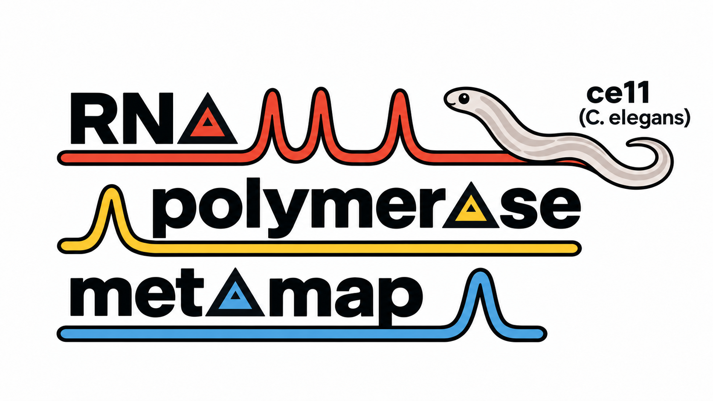

# Overview:

We applied a uniform, context-agnostic framework for scoring RNA polymerase (Pol) I, II, and III occupancies using ChIP-seq experiments performed in worm (C. elegans), facilitating unbiased annotation of polymerase occupancy and overlap. 

[](https://igv.org/app/?sessionURL=blob:zVZrT9swFP0ryJ82qdhpefTxDaqtqsQYAg1Nm1DlJJfEmmMX2yFAxX_fdZK.BiXdhAaREse.5z7O8Y3iGbkFY4VWZED2aI_2SIvYVBcXPJtKOOUZWDK45tJCixi4BgMqAjKYERGjRwTtNjoohOFsSHdAQsKV3fngLR_R5Ap9LNy38xO0p85N7YCxNIl1oaTmMbUaaB7ZiEKcs0TLGNQZdynz7iwUyQ8xteWEdkLhMF6RagkjUDqDSwEFGTiTY2nRvdMhV_G_JYq54yG3wHyYYwwzjkFTd.do8oA5uRTcvgKFKDU6O_LBfGwMXC5oi1y.mhgMGfz0S.PKMl6M85fLaqyH7.SqjnAhHuDV6qPWR8MUaR5aX9E8pEhuqTYJS0rxLfP2Kgi.1YSa0pc.o.FnFgQB3h3W7x34.STwVwdn9HAR7uqxRaSOcqwCt0BieKMFVoS0neHRL1_djLj7qe89Czd52Zotoistd_tB0G33.52D_e5.0O.3H1szkhu5olIinE8W6YxdcnWsjZNwwkN2fno01fI.A4NNMcnA8YxPJ8O6uXdL0oYXDD8I1AF4bFnGhWJnWnbKB_rEgqtJpHPl7ERpk2ETPUBMw2L5vWyBvBYStkfXzA_Qz1sceuEGFyLxH2Klk5.8gRA20gYsDSEeGT5Nn9fgKWgD_afAmvnhKnOIk9r6v7nvlY.tm6AJua5CE7qWovsemmBdiJea4AXQBvobm6D3DppgnIz8vV0LNANXJGgG1zL037wB_hBh4_a_iHme.sbNbwfvYPe_5NKJoeTWnvkfvAMz_FT5.IqXxBtxK.QbsXMB2usCLLlzpbTjzp_18E8NIkkR0g28HOVhzrOAm2FuuFst8rxc3lmur2v312csFYUCY14sUi0PWkLFcIc55gfOBQ8sDY8dUJ4wstXsRVFQH5AqmVElUproW1YRqYeJxe2KHFttEX81ynL1.Bs-)  
*Middle-click or Cmd/Ctrl + click badge to open in a new tab*

The composite tracks are truncated at 3 normalized counts to accommodate GitHub's maximum file-size limit. Score tracks are truncated at 0.25.

